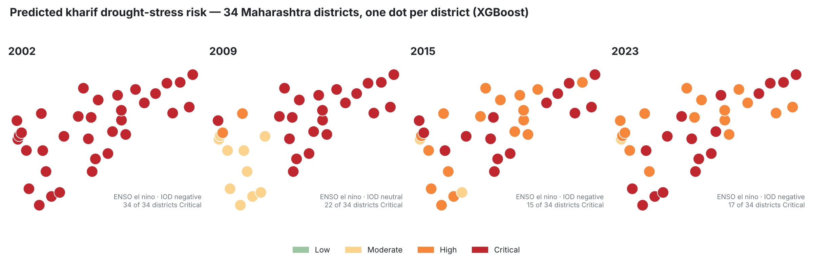
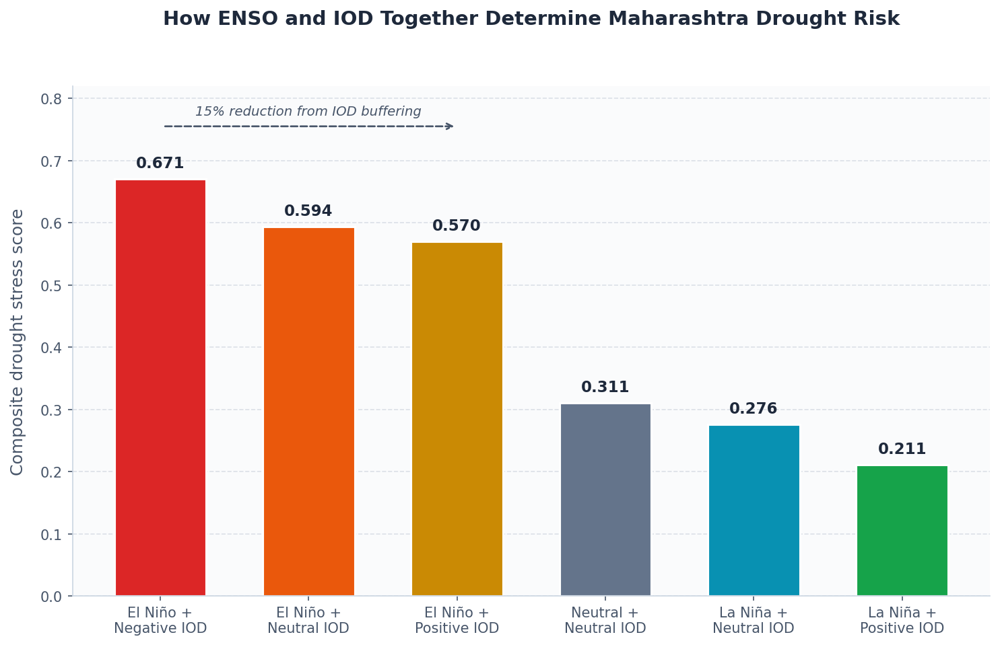
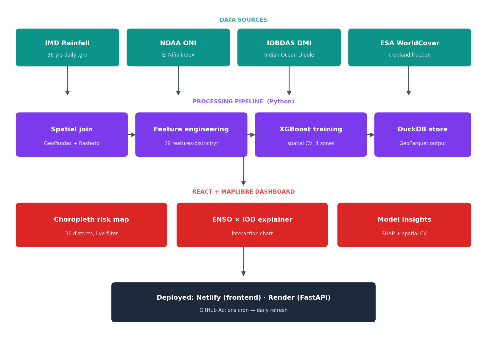

# Varsha — Kharif Crop Stress Mapper

**Predicting monsoon-driven drought stress for kharif crops across Maharashtra's districts, using ENSO, the Indian Ocean Dipole and IMD rainfall.**

🌐 **Live app:** [varsha-kharif-mapper.netlify.app](https://varsha-kharif-mapper.netlify.app/)
📝 **Article:** [I built an AI model to predict India's monsoon failures (Medium)](https://medium.com/@anushakiran156/i-built-an-ai-model-to-predict-indias-monsoon-failures-5118dbd75731)



## Why

In most years, the kharif season's fate is decided by the June–September monsoon. El Niño years usually bring deficits, but not always, because the Indian Ocean Dipole can amplify or offset ENSO. Varsha models that interaction at the district level and classifies each district-year as **Low / Moderate / High / Critical** drought-stress risk.



## Architecture



| Step | Script | What it does |
|---|---|---|
| 1 | `pipeline/01_ingest.py` | Downloads IMD gridded rainfall (`imdlib`), NOAA Niño 3.4 / ONI, BOM DMI, ESA WorldCover tiles, district boundaries, ICRISAT crop calendar |
| 2 | `pipeline/02_spatial_join.py` | JJAS rainfall per district, cropland fraction and climate indices joined into a district × year panel; stored as GeoParquet and in a DuckDB feature store |
| 3 | `pipeline/03_features.py` | ENSO phases reclassified with the CPC ONI rule (±0.5 °C, ≥ 5 months); lag and ENSO × IOD interaction features; 29 features in total |
| 4 | `pipeline/04_train_model.py` | Class-weighted, multi-class XGBoost with leave-one-agro-zone-out spatial CV; SHAP and gain importance |

The frontend (`kharif-frontend/`) is built with **React 19 + Vite**, **MapLibre GL**, **deck.gl** and **Recharts**. It has three views: a risk map with a year filter, an ENSO × IOD explainer, and model insights.

## Results

Spatial cross-validation holds out one agro-climatic zone per fold, so the model is always tested on a region it never saw during training.

| Held-out zone | Accuracy | Macro F1 |
|---|---|---|
| Konkan | 0.918 | 0.858 |
| Marathwada | 0.977 | 0.968 |
| Vidarbha | 0.948 | 0.930 |
| Western Maharashtra | 0.943 | 0.907 |
| **Mean** | **0.947 ± 0.021** | **0.916 ± 0.040** |

The panel covers 1,122 district-years: 34 districts from 1992 to 2024. The top drivers by gain are `enso_offset_iod`, pre-monsoon ONI (`oni_mam_mean`), the `enso_iod_compound` flag, peak JJAS ONI and `drought_streak`.

## Run it locally

**Pipeline**

```bash
conda create -n varsha python=3.11 -y
conda activate varsha
conda install -c conda-forge geopandas rasterio duckdb pyarrow xgboost shap scikit-learn tqdm requests -y
pip install imdlib

cd kharif-crop-stress-map
python pipeline/01_ingest.py
python pipeline/02_spatial_join.py
python pipeline/03_features.py
python pipeline/04_train_model.py
```

**Frontend**

```bash
cd kharif-crop-stress-map/kharif-frontend
npm install
npm run dev
```

## Data

The processed outputs are in the repo, under `data/processed/`: the model, features, predictions and the DuckDB store. The large raw files are **not** in the repo, and `01_ingest.py` downloads them:

| Source | Used for | Size |
|---|---|---|
| [IMD 0.25° gridded rainfall](https://imdpune.gov.in/) via `imdlib` | JJAS rainfall per district | ~25 MB/yr |
| [ESA WorldCover 2021](https://esa-worldcover.org/) (N15E072, N15E075, N15E078) | Cropland fraction | ~300 MB |
| [NOAA CPC ONI / Niño 3.4](https://origin.cpc.ncep.noaa.gov/products/analysis_monitoring/ensostuff/ONI_v5.php) | ENSO phase | small, in repo |
| [BOM / IOBDAS DMI](http://www.bom.gov.au/climate/enso/indices.shtml) | Indian Ocean Dipole | small, in repo |
| ICRISAT district crop calendar | Dominant kharif crop and sensitivity | small, in repo |

## Limitations

- **Rule-based labels.** The risk labels come from thresholds on a composite stress score that is built from rainfall deficit and the climate indices. The model therefore learns to reproduce an index, not observed crop-yield losses. The next step is to validate against district yield or crop-insurance claims data.
- **No rainfall forecast.** Features use observed JJAS rainfall. For a true pre-season forecast, the model would need only predictors known before June, such as pre-monsoon ONI and DMI.
- **Approximate district geometry.** Districts are represented by their centroids, and the cropland fraction falls back to a synthetic 0.25° grid when the ESA tiles are missing.

---
*Built by [Anusha](https://github.com/anusha-0)*
